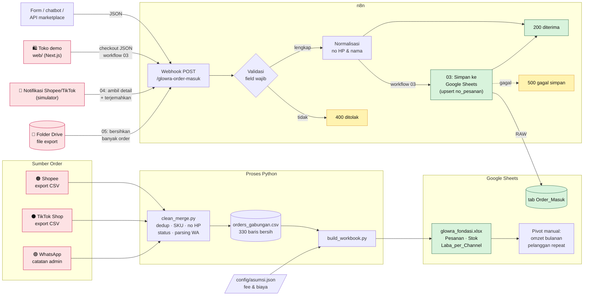

# OrderSync Beauty

**Studi kasus: sinkronisasi order Shopee, TikTok Shop & WhatsApp ke pembukuan, stok, dan data pelanggan, untuk toko skincare "Glowra Beauty".**

> ⚠️ **Glowra Beauty adalah toko fiktif.** Semua nama, nomor HP, nomor pesanan, dan angka di repo ini adalah **data dummy** yang dibuat untuk portofolio. Nomor HP memakai pola `08xx-555-xxxx` sebagai penanda fiktif.

---

## 1. Masalah seller

Glowra Beauty jualan di **3 tempat sekaligus**: Shopee, TikTok Shop, dan WhatsApp. Tiga pintu masuk order, tapi hanya **satu gudang** dan **satu buku kas**. Setiap minggu admin:

- Download export Shopee (bahasa Indonesia) dan TikTok (bahasa Inggris), dengan format kolom, tanggal, dan status yang **berbeda**.
- Menyalin order WhatsApp dari chat ke Excel **dengan tangan**: `98rb`, `2 pcs`, `kak dewi`, `sunscren spf50`…
- Menggabungkan semuanya pakai copy-paste. Hasilnya ada **baris dobel**, **SKU salah ketik**, dan **pelanggan sama tercatat jadi beberapa orang** karena nomor HP ditulis `0812…`, `62812…`, `+62 812-…`.
- Menghitung laba dari **harga jual**, padahal yang cair dari marketplace sudah **dipotong fee**.
- Baru sadar stok habis **saat ada pesanan masuk**.

13 titik rawan dipetakan di [`docs/01-peta-alur-bisnis.md`](docs/01-peta-alur-bisnis.md). 10 di antaranya diselesaikan di project ini.

## 2. Solusi

Fondasi data & otomasi dalam 8 lapis:

| Lapis | Yang dilakukan | File |
|---|---|---|
| **1. Gabung & bersihkan** | Satu perintah menggabungkan 3 channel jadi satu tabel seragam: buang duplikat, perbaiki SKU, seragamkan no HP ke `628…`, ubah catatan WA berantakan jadi data terstruktur | [`scripts/clean_merge.py`](scripts/clean_merge.py) |
| **2. Hitung otomatis** | Spreadsheet berisi **rumus asli** (bukan angka mati): HPP, fee marketplace, laba per channel, stok akhir & status RESTOCK | [`sheets/glowra_fondasi.xlsx`](sheets/glowra_fondasi.xlsx) |
| **3. Asumsi terpusat** | Fee marketplace & biaya packing di **satu tempat**. Fee berubah? Ubah satu sel, semua laporan ikut | [`config/asumsi.json`](config/asumsi.json) |
| **4. Order masuk otomatis** | Webhook n8n menerima order, **menolak data tidak lengkap** dengan pesan jelas, merapikan no HP & nama, lalu membalas JSON | [`n8n/`](n8n/) |
| **5. Langsung tercatat** | Order yang lolos validasi **otomatis ditulis ke Google Sheets** (tab `Order_Masuk`), termasuk keranjang berisi banyak produk (1 produk = 1 baris). Kiriman ulang tidak bikin baris dobel, dan nomor pesanan 18 digit tetap utuh | [`n8n/03_…`](n8n/03_webhook_ke_google_sheets.json) · [`docs/05`](docs/05-webhook-ke-google-sheets.md) |
| **6. Toko demo** | Website toko Glowra (Next.js): katalog → keranjang → checkout → n8n → Google Sheets, dengan panel **"Di balik layar"** yang menunjukkan setiap langkah & JSON-nya. Untuk demo langsung ke calon klien | [`web/`](web/) · [`docs/06`](docs/06-toko-demo-website.md) |
| **7. Notifikasi marketplace** | Pola API resmi Shopee & TikTok: notifikasi → **ambil detail order** → terjemahkan → gerbang. Status pesanan (diproses → dikirim → selesai/batal) ikut diperbarui di sheet. Dicoba lewat halaman **Simulator** tanpa akun developer | [`n8n/04_…`](n8n/04_webhook_marketplace.json) · [`docs/07`](docs/07-simulator-marketplace.md) |
| **8. Import file export** | Seller taruh file export Shopee/TikTok di folder **Google Drive** → n8n membersihkan (dobel, SKU typo, status, tanggal) → ratusan order tercatat dalam 1 kali tulis + ringkasan di tab `Log_Import`. **Tanpa izin API** | [`n8n/05_…`](n8n/05_import_export_drive.json) · [`docs/08`](docs/08-import-export-drive.md) |

## 3. Arsitektur



Keputusan teknologi dan alasannya dicatat di [`ADR-001`](docs/adr/ADR-001-stack-fondasi.md) (stack fondasi) dan [`ADR-002`](docs/adr/ADR-002-google-sheets-service-account.md) (tulis ke Google Sheets).

## 4. Hasil (dari data dummy, periode 12 Agu s.d. 11 Nov 2026)

### Data yang dibereskan otomatis

| | Jumlah |
|---|---|
| Baris mentah dari 3 channel | **333** |
| Baris duplikat dibuang | **3** |
| SKU salah ketik diperbaiki | **3** |
| Nama produk berspasi berlebih dirapikan | **6** |
| Nomor HP diseragamkan ke `628…` | **210** |
| Catatan WA (teks bebas) dipetakan ke SKU | **30 / 30** |
| **Baris bersih** | **330** (Shopee 200 · TikTok 100 · WA 30) |

### Kinerja per channel (status selesai + dikirim)

| Channel | Order | Omzet | Fee Marketplace | Laba Bersih* | Margin |
|---|---|---|---|---|---|
| Shopee | 160 | Rp18.625.000 | Rp2.062.500 | Rp9.700.500 | 52,1% |
| TikTok Shop | 80 | Rp9.868.000 | Rp789.440 | Rp5.449.560 | 55,2% |
| WhatsApp | 24 | Rp2.659.000 | Rp0 | Rp1.683.000 | 63,3% |
| **Total** | **264** | **Rp31.152.000** | **Rp2.851.940** | **Rp16.833.060** | **54,0%** |

*Laba bersih = omzet − HPP − fee marketplace − packing. Belum termasuk iklan, gaji, dan sewa. Fee memakai **asumsi** di `config/asumsi.json`.

### Insight bisnis

- 💸 **Rp2,85 juta "hilang" ke fee marketplace** dalam 3 bulan. Kalau pembukuan memakai harga jual, laba terlihat sebesar itu lebih besar dari kenyataan.
- 🔁 **21,9% pelanggan repeat order** (55 dari 251 pelanggan unik). **31 di antaranya belanja lintas channel**: tanpa normalisasi nomor HP, mereka terhitung sebagai 2 orang berbeda dan tidak terdeteksi sebagai pelanggan setia.
- 📦 **3 produk perlu RESTOCK**: Niacinamide Serum (sisa 17, min. 25), UV Shield Sunscreen SPF50 (sisa 26, min. 30), Velvet Lip Tint Rosy (sisa 21, min. 25). Niacinamide Serum juga **produk dengan omzet tertinggi** (Rp5,1 juta), jadi produk andalan hampir habis.
- 📅 **Masa gajian (tgl 25–akhir bulan) menyumbang 37% order** padahal hanya ±23% dari jumlah hari. **11.11 jadi hari teramai.** Jadwal restock & promo sebaiknya mengikuti pola ini.
- 💬 **WhatsApp punya margin tertinggi (63%)** karena tanpa fee platform. Alasan kuat untuk mengarahkan pelanggan repeat ke WA.

### Kualitas & verifikasi

- Semua script **deterministik** (seed 42). Dijalankan 2×, hash seluruh file CSV **identik**.
- Workbook dihitung langsung oleh **Excel**: **2.149 rumus, 0 error**. Total omzet di Laba_per_Channel **cocok** dengan tab Pesanan (selisih Rp0), dan semua angka sama dengan hitungan ulang Python.
- Workflow n8n **diuji di n8n 2.47.4**: API publik → 5 produk. Webhook → **200** untuk order valid, **400** untuk order rusak, **404** untuk URL salah.
- Workflow 03 **diuji di n8n 2.47.4 yang berjalan sungguhan**: order rusak → **400**, keranjang dengan SKU dobel → **400**, kredensial Google palsu → **500** dengan detail error (bukan pura-pura sukses), dan jalur sukses (node Google diganti simulasi) → **200**. Header tab `Order_Masuk` diambil dari satu sumber yang sama dengan pemetaan kolom di workflow. *Penulisan ke Google Sheets asli belum diuji* karena butuh service account pemilik.
- Toko demo diuji end-to-end di browser (Edge): keranjang 3 produk → 200, total Rp414.000 cocok; kirim ulang → baris tidak bertambah; order rusak → 400; harga palsu dari browser diabaikan.
- **Tersambung ke Google Sheets asli** (service account): penulisan, upsert, dan kiriman banyak order sekaligus terverifikasi.
- Workflow 04 diuji dengan 6 skenario (Shopee HP disamarkan, TikTok qty 3 digabung, status → selesai memperbarui baris, belum bayar diabaikan, notifikasi asing → 400, order tidak ada → 500).
- Pembersih workflow 05 menghasilkan angka **sama persis** dengan `clean_merge.py` (Shopee 200 order, TikTok 100 order).

## 5. Tech stack

| Komponen | Teknologi |
|---|---|
| Generator & cleaning data | Python 3.12 (`csv`, `random`, `re`, tanpa library tambahan) |
| Spreadsheet | `openpyxl` → `.xlsx` → Google Sheets (SUMIFS, COUNTIFS, XLOOKUP, IF) |
| Otomasi | n8n: Manual Trigger, HTTP Request, Split Out, Edit Fields, Webhook, Code, IF, Respond to Webhook, Google Sheets & Google Drive Trigger (Service Account), Extract From File |
| Toko demo | Next.js 14 (App Router) + TypeScript + Tailwind CSS |
| Diagram | Mermaid (ter-render langsung di GitHub) |
| Format data | CSV UTF-8 with BOM, JSON |

## 6. Roadmap

| Tahap | Fitur | Nilai untuk seller |
|---|---|---|
| ✅ **Selesai** | Webhook order → **langsung tertulis ke Google Sheets** (anti dobel, keranjang multi-produk) | Tidak ada lagi input manual order WA |
| ✅ **Selesai** | **Toko demo** yang tersambung ke workflow | Calon klien bisa mencoba alurnya sendiri |
| ✅ **Selesai** | **Simulator notifikasi marketplace** (pola API Shopee/TikTok) + status pesanan ikut diperbarui | Siap dipindah ke API asli begitu ada izin partner |
| ✅ **Selesai** | **Import file export via Google Drive** | Bisa langsung dipakai seller tanpa izin API |
| **Berikutnya** | **Follow-up WA otomatis**: pengingat H+25 setelah pembelian (skincare habis ±1 bulan), ucapan terima kasih, minta review. Lewat WhatsApp Business Platform resmi | Repeat order naik tanpa admin harus ingat |
| | Notifikasi ke owner saat produk masuk status RESTOCK | Tidak kehabisan produk andalan |
| **Menengah** | **Sinkron stok real-time** antar channel via API resmi Shopee & TikTok (butuh otorisasi toko & persetujuan app partner) | Overselling hilang |
| | Rekonsiliasi dana cair vs pesanan selesai | Dana yang "nyangkut" ketahuan |
| **Lanjutan** | **Dashboard** omzet, laba, stok & pelanggan (Looker Studio / web) | Owner pantau bisnis dari HP |
| | Segmentasi pelanggan (baru, repeat, tidur) untuk promo yang tepat sasaran | Biaya promo lebih efisien |

## 7. Cara menjalankan

**Kebutuhan:** Python 3.10+ dan `pip install openpyxl`.

```bash
python scripts/generate_dummy.py   # 1. buat data dummy (seed 42)
python scripts/clean_merge.py      # 2. bersihkan & gabungkan, lalu tampilkan laporan
python scripts/build_workbook.py   # 3. buat sheets/glowra_fondasi.xlsx
python scripts/build_workflow_03.py # 4. buat workflow n8n 03 (gerbang order)
python scripts/build_workflow_04.py #    workflow 04 (notifikasi marketplace)
python scripts/build_workflow_05.py #    workflow 05 (import export Drive)
```

Lalu:
- Upload `.xlsx` ke Google Sheets, ikuti [`docs/03-panduan-google-sheets.md`](docs/03-panduan-google-sheets.md).
- Import workflow n8n, ikuti [`docs/04-api-webhook-penjelasan.md`](docs/04-api-webhook-penjelasan.md).
- Sambungkan ke Google Sheets (workflow 03), ikuti [`docs/05-webhook-ke-google-sheets.md`](docs/05-webhook-ke-google-sheets.md).
- Coba alurnya dari sisi pembeli lewat toko demo, ikuti [`docs/06-toko-demo-website.md`](docs/06-toko-demo-website.md).
- Coba notifikasi marketplace di `/simulator`, ikuti [`docs/07-simulator-marketplace.md`](docs/07-simulator-marketplace.md).
- Coba import file export lewat Google Drive, ikuti [`docs/08-import-export-drive.md`](docs/08-import-export-drive.md).

## 8. Struktur repo

```
ordersync-beauty/
├── README.md                       ← dokumen ini
├── catatan-belajar.md              ← refleksi pribadi
├── config/asumsi.json              ← fee marketplace & biaya (asumsi)
├── data/
│   ├── master_produk.csv           ← 15 produk
│   ├── raw/                        ← export mentah Shopee, TikTok, WA
│   └── clean/orders_gabungan.csv   ← hasil gabungan bersih
├── scripts/                        ← generate_dummy · clean_merge · build_workbook · build_workflow_03/04/05
├── sheets/glowra_fondasi.xlsx      ← workbook berisi rumus
├── n8n/                            ← 5 workflow + contoh payload tes
├── web/                            ← toko demo Glowra (Next.js)
└── docs/
    ├── adr/ADR-001-stack-fondasi.md
    ├── adr/ADR-002-google-sheets-service-account.md
    ├── 01-peta-alur-bisnis.md
    ├── 02-kamus-data.md
    ├── 03-panduan-google-sheets.md
    ├── 04-api-webhook-penjelasan.md
    ├── 05-webhook-ke-google-sheets.md
    ├── 06-toko-demo-website.md
    ├── 07-simulator-marketplace.md
    └── 08-import-export-drive.md
```

---

*Dibuat oleh Kevin, agensi otomasi untuk seller online. Tertarik menerapkan ini di toko Anda? [hubungi kontak agensi]*
