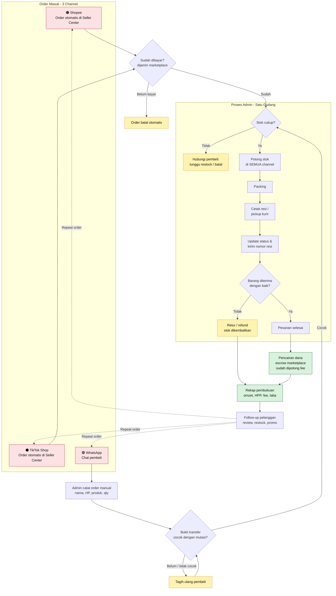

# 01 · Peta Alur Bisnis Glowra Beauty

> **Glowra Beauty** adalah toko skincare & beauty **fiktif** yang jualan di 3 tempat: **Shopee**, **TikTok Shop**, dan **WhatsApp**. Dokumen ini memetakan pekerjaan harian admin dari order masuk sampai pelanggan belanja lagi, lalu menunjukkan titik-titik yang paling sering bikin rugi.

---

## 1. Gambaran besar (pakai analogi)

Bayangkan toko kamu punya **tiga pintu masuk**:

- **Pintu Shopee** dan **pintu TikTok** dijaga satpam (sistem marketplace). Pembeli bayar ke satpam dulu, uangnya **dititipkan** (istilahnya *escrow*), dan baru diserahkan ke kamu setelah barang sampai dengan aman.
- **Pintu WhatsApp** tidak ada satpamnya. Pembeli chat langsung, transfer langsung ke rekening kamu, dan **admin yang harus mencatat semuanya sendiri**.

Di balik ketiga pintu itu cuma ada **satu gudang** dan **satu buku kas**. Masalah utama seller multi-channel ada di situ: data dari tiga pintu harus menyatu ke satu gudang dan satu buku tanpa ada yang tercecer.

---

## 2. Tahapan kerja admin

| # | Tahap | Apa yang terjadi | Shopee / TikTok | WhatsApp |
|---|---|---|---|---|
| 1 | **Order masuk** | Pembeli memesan produk. | Muncul otomatis di Seller Center dengan nomor pesanan resmi. | Masuk lewat chat. Admin menyalin nama, alamat, produk, dan jumlah ke catatan/Excel. |
| 2 | **Cek pembayaran** | Pastikan pesanan sudah dibayar sebelum diproses. | Sudah dijamin marketplace. Status "Perlu Dikirim" berarti sudah dibayar. | Admin minta bukti transfer lalu mencocokkan nominal ke mutasi rekening secara manual. |
| 3 | **Cek & potong stok** | Pastikan barang ada, lalu kurangi stok. | Stok di masing-masing marketplace harus diperbarui. | Admin cek gudang/Excel stok secara manual. |
| 4 | **Packing** | Barang dibungkus (bubble wrap, kardus, kartu ucapan). | Sama. | Sama. |
| 5 | **Cetak resi / pickup kurir** | Label pengiriman ditempel, kurir menjemput atau barang di-drop. | Resi dicetak dari Seller Center, kurirnya mengikuti pilihan pembeli. | Admin pesan kurir sendiri (atau lewat aplikasi kurir) lalu menyalin nomor resi. |
| 6 | **Update status & tracking** | Pembeli diberi tahu barang sudah dikirim. | Otomatis setelah resi di-scan kurir. | Admin kirim nomor resi lewat chat satu per satu. |
| 7 | **Pesanan selesai / retur** | Barang diterima, atau dikembalikan karena rusak/salah kirim. | Pembeli klik "Pesanan Diterima" (atau selesai otomatis). Retur diajukan lewat sistem. | Komplain masuk lewat chat. Retur dan refund diatur manual. |
| 8 | **Pencairan dana (escrow)** | Uang dari marketplace masuk ke saldo penjual. | Dana cair **setelah pesanan selesai**, sudah **dipotong** biaya admin, biaya layanan, program ongkir, dll. Jadi yang cair **lebih kecil** dari harga jual. | Tidak ada escrow, uang sudah masuk sejak tahap 2. |
| 9 | **Rekap pembukuan** | Hitung omzet, modal (HPP), biaya, dan laba. | Harus pakai **dana yang benar-benar cair**, bukan harga jual. | Harus dikurangi biaya packing & ongkir yang ditanggung toko (kalau ada). |
| 10 | **Follow-up & repeat order** | Hubungi pelanggan lama: tanya hasil pemakaian, tawarkan restock (misal serum habis ±30 hari), kirim promo. | Lewat chat marketplace (terbatas aturan platform) atau WA kalau ada izin pelanggan. | Langsung lewat WA. |

---

## 3. Diagram alur

> Diagram ini otomatis ter-render jadi gambar saat dibuka di GitHub. Untuk melihatnya di luar GitHub, salin isi blok kode ke <https://mermaid.live>.

**Cara membaca diagram:**
- Kotak **pink** = pintu masuk order.
- Kotak **kuning** = jalur "masalah" (batal, stok habis, retur, tagih ulang).
- Kotak **hijau** = urusan uang.
- **Garis putus-putus** = pelanggan kembali belanja (repeat order), bisa lewat channel yang berbeda dari pembelian pertama.

---

## 4. Titik yang Paling Sering Salah

Legenda kolom terakhir:
- ✅ **= dibangun di project ini** (bisa langsung didemokan ke calon klien)
- 🔜 = roadmap / layanan lanjutan

| # | Tahap | Kesalahan umum | Dampak ke bisnis | Ide otomasi |
|---|---|---|---|---|
| 1 | Cek & potong stok | **Stok tidak sinkron antar channel.** Barang laku di Shopee, tapi stok di TikTok masih tertulis ada. | **Overselling**: pesanan terpaksa dibatalkan, skor toko turun, pembeli kecewa dan kasih rating buruk. | ✅ Tab **Stok** menghitung stok akhir dari gabungan semua channel. 🔜 Sinkron stok real-time ke semua marketplace via API. |
| 2 | Order masuk (WA) | **Salah input order WA**: salah ketik nama produk, qty, atau tidak tercatat sama sekali. | Barang salah kirim, stok di catatan tidak cocok dengan gudang, omzet WA "hilang" dari laporan. | ✅ **Webhook n8n** dengan validasi field wajib, jadi order yang datanya tidak lengkap langsung ditolak dengan pesan jelas. |
| 3 | Data pelanggan | **Nomor HP formatnya beda-beda** (`0812…`, `62812…`, `+62 812-…`), sehingga satu orang tercatat sebagai beberapa pelanggan. | Jumlah pelanggan "membengkak", pelanggan setia tidak terdeteksi, promo terkirim dobel. | ✅ **Normalisasi nomor HP** ke format `628…` di script cleaning dan di webhook n8n. |
| 4 | Rekap pembukuan | **Pembukuan pakai harga jual, bukan dana yang benar-benar cair.** Fee admin & layanan marketplace lupa dihitung. | Laba di catatan **terlihat lebih besar** dari kenyataan. Bisa salah ambil keputusan (misal diskon terlalu dalam). | ✅ Kolom **Fee Marketplace** & **Laba Kotor** di tab Pesanan, dengan fee diambil dari tab **Asumsi**. |
| 5 | Retur | **Retur tidak tercatat**: barang balik ke gudang tapi stok tidak ditambah, atau omzetnya tidak dikurangi. | Stok di catatan lebih kecil dari fisik (atau sebaliknya), omzet terlalu tinggi. | ✅ Status **retur** diseragamkan dan dihitung terpisah di tab **Stok** & **Laba_per_Channel**. |
| 6 | Rekap pembukuan | **Data tiap channel beda format** (Shopee bahasa Indonesia, TikTok bahasa Inggris, WA tidak beraturan), jadi admin menggabungkan manual tiap minggu. | Makan waktu berjam-jam, rawan salah copy-paste, laporan selalu telat. | ✅ **Script `clean_merge.py`** menggabungkan semua channel jadi satu tabel seragam. |
| 7 | Rekap pembukuan | **Baris pesanan dobel** karena export diunduh dua kali atau copy-paste berulang. | Omzet & barang terjual tercatat lebih besar dari aslinya. | ✅ **Deteksi & buang duplikat** otomatis di script cleaning (dan dilaporkan jumlahnya). |
| 8 | Order masuk | **SKU typo / tidak konsisten** (`GLW-SRM-01` vs `GLW-SRM-001`), dan nama produk ada spasi berlebih. | Penjualan tidak terhitung ke produk yang benar, laporan per produk & stok jadi salah. | ✅ **Perbaikan SKU & rapikan spasi** di script cleaning, plus pengecekan ke Master Produk. |
| 9 | Cek & potong stok | **Telat restock**: baru sadar stok habis saat ada pesanan. | Kehilangan penjualan, apalagi saat tanggal kembar (11.11) dan gajian. | ✅ Status **AMAN / RESTOCK** otomatis di tab Stok berdasarkan stok minimum. 🔜 Notifikasi WA ke owner saat stok kritis. |
| 10 | Follow-up | **Lupa follow-up** pelanggan setelah barang diterima. | Kehilangan peluang repeat order (skincare itu produk habis pakai, jadi pelanggan lama adalah aset terbesar). | ✅ Identifikasi **pelanggan repeat** lewat pivot di Google Sheets. 🔜 Pengingat WA otomatis H+25 setelah pembelian. |
| 11 | Cek pembayaran (WA) | **Transfer belum masuk tapi barang sudah dikirim**, atau nominal tidak dicocokkan. | Rugi barang + ongkir, rawan penipuan bukti transfer palsu. | 🔜 Pencocokan mutasi rekening otomatis (via layanan mutasi bank / payment gateway). |
| 12 | Update status | **Nomor resi lupa dikirim** ke pembeli WA. | Pembeli terus chat menanyakan "paket saya mana?", beban CS bertambah. | 🔜 Kirim resi otomatis via WhatsApp Business API setelah resi diinput. |
| 13 | Pencairan dana | **Dana escrow tidak dicek**: ada pesanan selesai tapi dananya tidak cair atau potongannya aneh. | Uang "nyangkut" tanpa disadari. | 🔜 Rekonsiliasi otomatis: cocokkan laporan pencairan dengan daftar pesanan selesai. |

**Ringkasan untuk bahan jualan:** dari 13 titik rawan di atas, **10 titik sudah punya fondasi otomasinya di project ini** (✅). Sisanya (🔜) adalah layanan lanjutan yang bisa ditawarkan sebagai paket berikutnya.

---

## 5. Kenapa ini penting buat pemilik toko?

- **Waktu:** admin yang menggabungkan data 3 channel manual bisa habis **beberapa jam per minggu** hanya untuk copy-paste.
- **Uang:** selisih "harga jual vs dana cair" di marketplace bisa belasan persen per pesanan. Kalau tidak dihitung, toko bisa merasa untung padahal tipis atau malah rugi.
- **Pelanggan:** di bisnis skincare, pelanggan yang beli ulang itu "tambang emas". Data pelanggan yang dobel dan follow-up yang terlupa membuat peluang itu lepas.

> Catatan: semua nama toko, pelanggan, dan angka di project ini **fiktif** dan dibuat untuk keperluan portofolio.
