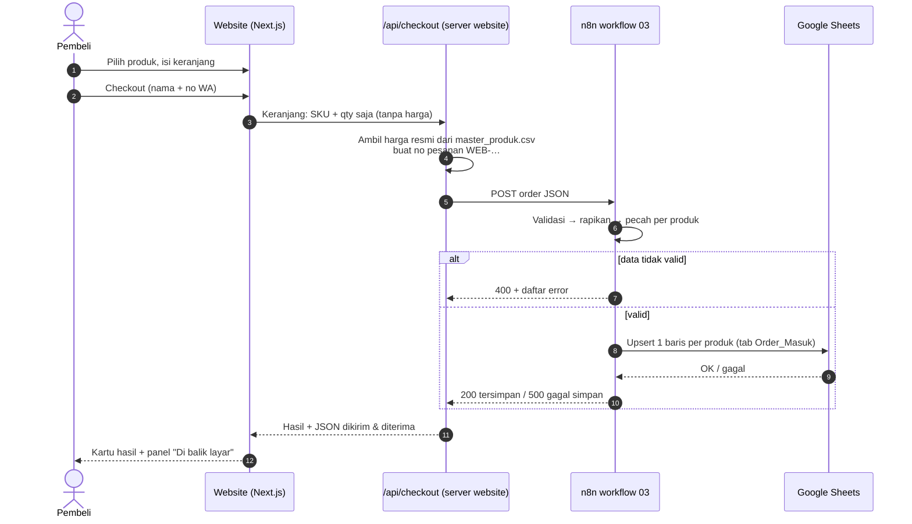

# 06 · Toko demo Glowra (website → n8n → Google Sheets)

Website toko kecil di folder `web/` untuk **mencoba seluruh alur dari sisi pembeli**: pilih produk → checkout → order diperiksa n8n → tercatat di Google Sheets. Cocok untuk demo ke calon klien, karena mereka bisa melihat sendiri prosesnya.

> **Analogi:** website ini adalah **etalase dan kasir**. n8n adalah **satpam dan juru catat** di belakang. Google Sheets adalah **buku besar**. Pembeli hanya berhadapan dengan kasir, tapi setiap transaksi otomatis sampai ke buku besar.

---

## Alurnya



### Kenapa ada `/api/checkout` di tengah, bukan browser langsung ke n8n?

| Alasan | Penjelasan |
|---|---|
| **Harga tidak bisa diakali** | Browser hanya mengirim SKU + qty. Harga diambil server dari `data/master_produk.csv`. Kalau ada yang iseng mengirim `harga_satuan: 1`, harga itu diabaikan. |
| **Alamat n8n tersembunyi** | URL webhook ada di file `.env.local` di server, tidak terlihat di browser pembeli. |
| **Tidak kena CORS** | Browser melarang halaman memanggil domain lain sembarangan. Server ke server tidak dibatasi. |

Validasi nama, nomor HP, SKU, dan qty **tidak diduplikasi di website**. Semuanya dilakukan n8n, jadi aturannya hanya ada di satu tempat.

### Satu sumber data produk

Website membaca `data/master_produk.csv`, file yang sama dengan yang dipakai script Python dan workbook. Ganti harga di CSV → website, workbook, dan laporan ikut berubah. HPP **tidak pernah** dikirim ke browser.

---

## Cara menjalankan (lokal)

> **Jalan pintas (kalau n8n & kredensial sudah pernah disiapkan):** klik kanan `C:\Users\Kevin\ordersync-beauty\jalankan-demo.ps1` → **Run with PowerShell**. Script ini menyalakan n8n (data di folder `.n8n`, tidak ikut ke Git) dan toko demo sekaligus, lalu buka http://localhost:3000.

**Kebutuhan:** Node.js (sudah terinstal), n8n berjalan dengan workflow 03 (lihat `docs/05`).

1. **Siapkan n8n & workflow 03** sesuai `docs/05` (kredensial Google + URL sheet), lalu klik **Publish** di kanan atas workflow. Setelah di-Publish, alamat webhook-nya `http://localhost:5678/webhook/glowra-order-sheets` (tanpa `-test`) dan selalu siap menerima order.
2. Buka PowerShell baru:
   ```powershell
   cd C:\Users\Kevin\ordersync-beauty\web
   npm install
   copy .env.example .env.local
   ```
   `npm install` hanya perlu sekali (±1-2 menit).
3. Buka `C:\Users\Kevin\ordersync-beauty\web\.env.local` dengan Notepad:
   - `N8N_WEBHOOK_URL` sudah terisi alamat lokal. Biarkan saja kalau n8n jalan di laptop.
   - (Opsional) isi `NEXT_PUBLIC_SHEET_URL` dengan link Google Sheet-mu, supaya muncul tombol **Buka Google Sheets** setelah checkout.
4. Jalankan website:
   ```powershell
   npm run dev
   ```
5. Buka **http://localhost:3000**. Jangan tutup terminal n8n dan terminal website selama demo.

> Mau tes tanpa Publish? Ganti `N8N_WEBHOOK_URL` ke `…/webhook-test/glowra-order-sheets`, lalu klik **Listen for test event** di n8n **sebelum setiap** checkout. Setelah mengubah `.env.local`, matikan website (`Ctrl + C`) lalu jalankan ulang `npm run dev`.

---

## Skenario demo untuk calon klien (±5 menit)

Di halaman checkout ada kotak **Alat demo**:

| # | Lakukan | Yang terlihat | Pesan ke klien |
|---|---|---|---|
| 1 | Masukkan 3 produk ke keranjang → **Isi data berantakan** → **Pesan sekarang** | Kartu hijau. Nama `kak dewi   lestari` jadi **Dewi Lestari**, HP `+62 812-555-1234` jadi **628125551234**. Di sheet muncul **3 baris** | "Admin tidak perlu merapikan apa pun" |
| 2 | Klik **Kirim ulang order terakhir** | Tetap hijau, tulisan *kiriman ULANG*. Di sheet **tidak ada baris baru** | "Koneksi putus lalu terkirim dua kali? Tidak jadi dobel" |
| 3 | Klik **Kirim order rusak** | Kartu kuning + daftar alasan. Panel: langkah Validasi ✕, Normalisasi & Sheets dilewati | "Data sampah tidak pernah masuk ke pembukuan" |
| 4 | Matikan n8n (`Ctrl + C`), lalu checkout lagi | Kartu merah *tidak bisa menghubungi n8n* | "Kalau sistem mati, pembeli diberi tahu, bukan pura-pura berhasil" |

Panel **Di balik layar** menunjukkan 6 langkah (✓ / ✕ / dilewati), HTTP status, lama proses (ms), dan JSON yang dikirim & diterima.

### Arti warna kartu hasil

| Warna | Kondisi | HTTP dari n8n |
|---|---|---|
| 🟢 Hijau | Tercatat di sheet | 200 |
| 🟡 Kuning | Ditolak, data tidak valid | 400 |
| 🔴 Merah | Data valid tapi gagal ditulis ke Google, atau n8n tidak bisa dihubungi / webhook belum di-Publish | 500 / 404 / tanpa balasan |

---

## Kalau ada masalah

| Gejala | Penyebab | Solusi |
|---|---|---|
| *N8N_WEBHOOK_URL belum diisi* | File `.env.local` belum dibuat | Ulangi langkah 2-3, lalu jalankan ulang `npm run dev` |
| *Tidak bisa menghubungi n8n* | n8n mati | Cek terminal `npx n8n` masih terbuka |
| *Webhook tidak ditemukan (404)* | Workflow 03 belum di-Publish, atau memakai `/webhook-test/` tanpa *Listen* | Klik **Publish** di workflow 03 |
| Kartu merah *gagal ditulis ke Google Sheets* | Masalah kredensial/sheet | Lihat *Detail dari Google* di kartu, lalu cek tabel masalah di `docs/05` |
| Harga di website beda dengan sheet | `master_produk.csv` diubah saat website jalan | Jalankan ulang `npm run dev` (daftar produk dibaca sekali saat mulai) |

---

## Struktur folder `web/`

```
web/
├── app/
│   ├── page.tsx              ← beranda: hero, "di balik layar", katalog
│   ├── checkout/page.tsx     ← halaman checkout
│   └── api/checkout/route.ts ← jembatan ke n8n (harga dari server, no pesanan, timeout 20 detik)
├── components/               ← Katalog, Keranjang (laci), Checkout, BalikLayar, ilustrasi produk
├── lib/produk.ts             ← membaca ../data/master_produk.csv
└── .env.example              ← contoh pengaturan (salin jadi .env.local)
```

## Batasan (jujur ke klien)

- **Toko fiktif:** tidak ada pembayaran, ongkir, atau pesan WhatsApp sungguhan.
- Stok belum dicek saat checkout (masih tahap roadmap "sinkron stok").
- Belum bisa di-online-kan apa adanya: website membaca CSV dari folder induk, dan n8n masih lokal. Untuk online, butuh n8n Cloud/server dan daftar produk ikut di-deploy (misalnya disalin ke `web/` saat build).
