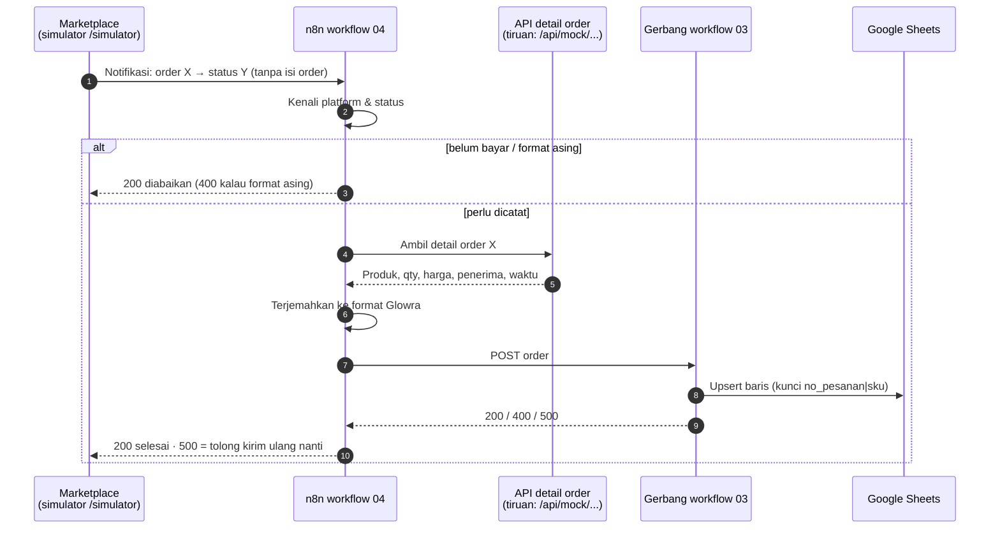

# 07 · Cara 1: Simulator Marketplace (Shopee & TikTok Shop)

Mencoba alur **integrasi API marketplace** tanpa akun developer Shopee/TikTok. Halaman `/simulator` di toko demo berpura-pura menjadi marketplace; n8n memprosesnya **dengan pola yang sama** seperti API asli.

> **Analogi:** marketplace itu seperti kurir yang hanya menelepon, *"Paket nomor X statusnya sudah dikirim."* Ia tidak membacakan isi paketnya. Kalau mau tahu isinya, kita yang harus **menelepon balik** ke gudang marketplace (API detail order). Workflow 04 melakukan dua langkah itu.

---

## Alurnya

### Status marketplace → status di sheet

| Shopee | TikTok Shop | `status_pesanan` di sheet |
|---|---|---|
| UNPAID | UNPAID, ON_HOLD | *(tidak dicatat)* |
| READY_TO_SHIP, PROCESSED | AWAITING_SHIPMENT, AWAITING_COLLECTION | `diproses` |
| SHIPPED, TO_CONFIRM_RECEIVE | IN_TRANSIT, DELIVERED | `dikirim` |
| COMPLETED | COMPLETED | `selesai` |
| IN_CANCEL, CANCELLED | CANCELLED | `batal` |
| TO_RETURN | — | `retur` |

Setiap perubahan status mengirim notifikasi baru. Baris order yang sama **diperbarui**, jadi kolom `status_pesanan` di sheet selalu mengikuti status terakhir.

### Perbedaan Shopee vs TikTok yang ditangani

| Hal | Shopee | TikTok Shop | Penanganan di n8n |
|---|---|---|---|
| Nomor pesanan | `261113DM4JYXWJ` (huruf + angka) | `990027742896388669` (18 digit) | Disimpan sebagai teks (cell format RAW) supaya tidak rusak |
| Jumlah barang | 1 baris produk + `model_quantity_purchased` | **1 line item = 1 unit** (qty 3 = 3 line item) | Digabung per SKU → 1 baris qty 3 |
| Nomor HP | `628…`, sering disamarkan `******34` | `(+62)8…`, sering disamarkan | Nomor disamarkan tetap diterima (khusus channel marketplace), kolom `no_hp_normal` dikosongkan |
| Waktu | Unix timestamp | Unix timestamp | Diubah ke WIB `YYYY-MM-DD HH:mm` |

---

## Cara mencoba

1. Pastikan n8n dan toko demo menyala (`jalankan-demo.ps1`, lihat [`06`](06-toko-demo-website.md)), dan workflow **03 + 04** sudah di-Publish.
2. Buka **http://localhost:3000/simulator**.
3. Pilih **Shopee** atau **TikTok Shop**, klik **🎲 Acak isi order** (atau pilih produk sendiri), lalu klik **Kirim notifikasi order …**
4. Lihat kartu hasil dan panel **Di balik layar** (7 langkah). Buka Google Sheets: baris baru muncul dengan `status_pesanan = diproses`.
5. Di kolom kanan **Ubah status order**, pilih status baru (misalnya *Selesai*), lalu klik **Kirim**. Baris yang sama di sheet berubah jadi `selesai`.

### Skenario demo untuk klien

| Lakukan | Yang terlihat | Pesan ke klien |
|---|---|---|
| Order TikTok qty 3 | 1 baris qty 3, bukan 3 baris | "Keanehan format tiap marketplace sudah ditangani" |
| Ubah status → Selesai | Baris yang sama berubah status | "Status pesanan selalu terbaru, tanpa update manual" |
| Ubah status → Belum bayar | Kartu biru *diabaikan* | "Order yang belum dibayar tidak mengotori pembukuan" |
| Centang *Samarkan nomor HP* | Tetap tercatat, nomor kosong | "Sistem siap dengan batasan data dari API asli" |

---

## Dari simulator ke API asli

| Bagian | Demo | Versi asli |
|---|---|---|
| Pengirim notifikasi | Halaman `/simulator` | Shopee Open Platform *Push Mechanism* / TikTok Shop *Webhooks*, diatur di portal developer |
| Alamat webhook | `http://localhost:5678/webhook/glowra-marketplace` | Alamat n8n yang **online** (n8n Cloud / server), harus HTTPS |
| API detail order | `/api/mock/shopee/order-detail`, `/api/mock/tiktok/orders` | `…/api/v2/order/get_order_detail` (Shopee), `…/order/202309/orders` (TikTok) |
| Keamanan | Tidak ada | **Verifikasi tanda tangan** (signature) notifikasi + access token toko (OAuth) yang diperpanjang berkala |

Yang **tidak berubah**: logika "kenali → ambil detail → terjemahkan → gerbang 03", pemetaan status, dan penulisan ke Google Sheets.

> Bentuk JSON simulator mengikuti garis besar dokumentasi resmi. Saat integrasi sungguhan, nama field persisnya tetap harus dicocokkan dengan dokumentasi terbaru Shopee Open Platform dan TikTok Shop Partner Center, karena keduanya rutin memperbarui versi API.

## Batasan

- Order simulasi disimpan di **memori** server toko. Kalau toko dimatikan, daftar di kolom kanan hilang (baris di Google Sheets tetap ada).
- Webhook tidak memverifikasi tanda tangan. Jangan membuka alamat webhook ini ke internet tanpa menambahkan verifikasi.
