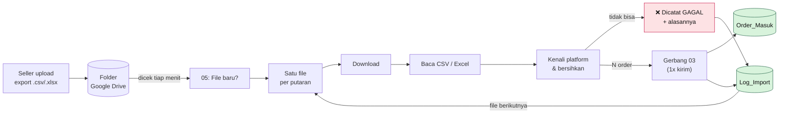

# 08 · Cara 2: Import File Export Marketplace lewat Google Drive

Cara paling realistis untuk UMKM: **tidak perlu izin API**. Semua seller bisa download file export pesanan dari Shopee Seller Centre atau TikTok Seller Center. Seller cukup menaruh file itu di satu folder Google Drive, dan n8n yang membersihkan serta mencatatnya.

> **Analogi:** folder Drive itu **kotak surat**. Seller memasukkan "surat" (file export), dan n8n adalah petugas yang mengecek kotak tiap menit, membuka suratnya, merapikan isinya, lalu menyalinnya ke buku besar (Google Sheets).

---

## Alurnya

### Yang dibersihkan otomatis (sama dengan `scripts/clean_merge.py`)

| Masalah di file export | Penanganan |
|---|---|
| Baris dobel (order + SKU sama) | Dibuang, dihitung di laporan |
| SKU salah ketik (`GLW-SRM-01`, `glw-sns001`) | Diperbaiki ke `GLW-SRM-001` |
| Status beda bahasa (`Perlu Dikirim`, `Awaiting Shipment`) | Diseragamkan: `diproses`, `dikirim`, `selesai`, `batal`, `retur` |
| Order belum dibayar | Dilewati |
| Format tanggal beda (`2026-11-11 23:02` vs `12/08/2026 00:40:50`) | Diseragamkan ke `YYYY-MM-DD HH:mm` |
| Order berisi beberapa produk (1 baris per produk) | Dikelompokkan per order |
| Baris keterangan di bawah header (ada di sebagian export TikTok) | Dilewati |
| Nama kolom alternatif (`Nomor Referensi SKU` / `SKU Induk`, `Harga Setelah Diskon` / `Harga Awal`) | Dipilih yang ada |
| Nomor HP & nama berantakan | Dirapikan oleh gerbang 03 |

Kalau beberapa file di-upload bersamaan, n8n memprosesnya **satu per satu** supaya isi file Shopee dan TikTok tidak tercampur. File yang tidak bisa diimport tetap dicatat di `Log_Import` beserta alasannya.

Semua order dari satu file dikirim ke gerbang **dalam satu kali kirim**. Ini penting karena Google Sheets membatasi jumlah penulisan per menit; ratusan order yang dikirim satu per satu akan kena batas.

**Upload ulang file yang sama aman.** Baris yang sudah ada diperbarui, misalnya status berubah dari `diproses` ke `selesai` di export minggu berikutnya, dan tidak ada yang dobel.

### Tab `Log_Import`

Setiap import menambah 1 baris ringkasan: waktu, nama file, platform, jumlah baris mentah, duplikat dibuang, SKU diperbaiki, order tercatat/ditolak. Pemilik toko bisa memantau import **tanpa membuka n8n**.

---

## Setup (sekali saja, ±5 menit)

1. **Buat folder** di Google Drive, misalnya `Glowra - Export Marketplace`.
2. **Bagikan folder** itu ke email robot `n8n-glowra@…iam.gserviceaccount.com` sebagai **Editor** (klik kanan folder → Bagikan).
3. Di Google Sheet, **tambah tab baru** bernama persis `Log_Import` dan biarkan kosong. Header-nya dibuat otomatis saat import pertama.
4. Di n8n, buka workflow 05, lalu di node **File Baru di Folder Drive** isi **ID folder**. ID folder adalah bagian link setelah `/folders/`, contoh `https://drive.google.com/drive/folders/`**`1AbC…xyz`**.
5. Di node **Catat ke Log_Import**, isi URL Google Sheet, lalu klik **Publish**.

## Cara mencoba

1. Upload file ke folder Drive tadi:
   - `C:\Users\Kevin\ordersync-beauty\data\raw\shopee_orders.csv` (202 baris → 200 order)
   - `C:\Users\Kevin\ordersync-beauty\data\raw\tiktok_orders.csv` (101 baris → 100 order)
2. Tunggu **1-2 menit**, karena n8n mengecek folder tiap menit.
3. Buka Google Sheets:
   - `Order_Masuk`: ±300 baris baru dengan `status_pesanan` dan `tanggal_pesanan` terisi.
   - `Log_Import`: 2 baris ringkasan (Shopee: 2 duplikat dibuang, 2 SKU diperbaiki; TikTok: 1 dan 1).
4. Di n8n → workflow 05 → **Executions** terlihat jejak tiap import.

> n8n hanya memproses file yang dibuat **setelah** workflow di-Publish. File yang sudah ada di folder sebelumnya tidak diproses.

## Kalau ada masalah

| Gejala | Penyebab | Solusi |
|---|---|---|
| File di-upload tapi tidak ada yang terjadi | Folder belum dibagikan ke robot, atau workflow belum di-Publish | Cek langkah setup 2 & 5 |
| Error *Google Drive API has not been used* | Drive API belum di-enable | console.cloud.google.com → Library → **Google Drive API** → Enable |
| `Log_Import` berisi *GAGAL: bukan file export Shopee/TikTok* | File lain (atau kolom header diubah) | Upload file export asli tanpa diedit |
| `Log_Import` berisi *GAGAL: kolom wajib tidak ditemukan* | Versi export punya nama kolom berbeda | Tambahkan nama kolom itu ke `KOLOM` di node *Kenali & Bersihkan Export* (atau di `scripts/build_workflow_05.py`) |
| `Log_Import` kosong padahal order masuk | Tab `Log_Import` belum dibuat atau namanya beda | Buat tab dengan nama persis `Log_Import` |

## Batasan (jujur ke klien)

- Download dari Seller Centre masih **manual**, karena itu bagian yang butuh izin API untuk diotomasi (lihat [`07`](07-simulator-marketplace.md)).
- Export asli bisa berbeda antar versi dan negara. Pemetaan kolom disiapkan untuk beberapa nama umum; file dari klien nyata perlu dicek sekali di awal.
- Nama produk tidak diperiksa ke master produk, hanya format SKU-nya. SKU yang formatnya benar tapi tidak ada di katalog tetap tercatat dan perlu dicek di sheet.
