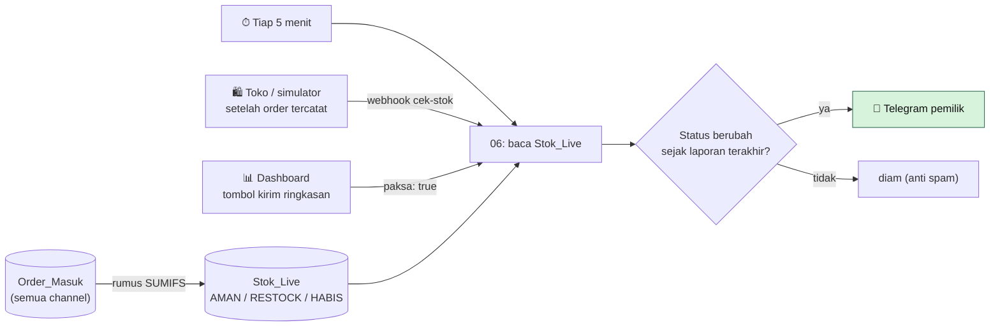

# 09 · Stok Otomatis & Notifikasi RESTOCK ke Telegram

Menjawab masalah seller: *"baru sadar stok habis saat ada pesanan masuk."* Stok berkurang sendiri setiap ada order tercatat, dan pemilik toko mendapat pesan Telegram begitu sebuah produk menyentuh batas minimum.

> **Analogi:** tab `Stok_Live` itu **timbangan** yang selalu menunjukkan isi gudang. Workflow 06 adalah **penjaga gudang** yang melirik timbangan tiap 5 menit. Kalau ada rak yang mulai kosong, ia langsung mengirim pesan Telegram ke pemilik. Ia tidak mengulang laporan yang sama terus-menerus.

---

## Alurnya



### 1. Stok dihitung oleh rumus (tab `Stok_Live`)

| Kolom | Rumus | Arti |
|---|---|---|
| Stok Awal | dari `Master_Produk` | Stok saat mulai pencatatan |
| Dipesan | jumlah qty order **baru + diproses** | Sudah dibeli tapi belum dikirim. Tetap dihitung supaya tidak *oversell* |
| Terjual | jumlah qty order **dikirim + selesai** | Sudah keluar gudang |
| Stok Tersedia | Awal − Dipesan − Terjual | Yang masih bisa dijual |
| Status | `HABIS` (≤ 0), `RESTOCK` (< minimum), `AMAN` | Dipantau workflow 06 |

Order **batal** dan **retur** tidak mengurangi stok. Kalau order dibatalkan, misalnya status dari marketplace berubah jadi *Cancelled*, stoknya otomatis kembali.

> **Catatan bahasa sheet:** Google Sheets berbahasa Indonesia memakai **titik koma** sebagai pemisah rumus (`=SUMIFS(A:A;B:B;"x")`). File `.xlsx` dari repo memakai koma, dan Google Sheets menerjemahkannya otomatis saat file di-upload.

### 2. Workflow 06: pemantau & pengirim notifikasi

- **Kapan jalan:** tiap 5 menit, plus **langsung** setiap order tercatat (toko demo dan simulator memanggil webhook `/glowra-cek-stok`).
- **Anti spam:** n8n mengingat status terakhir tiap produk. Pesan hanya dikirim saat status **berubah**: AMAN → RESTOCK/HABIS, atau sebaliknya ("sudah aman lagi").
- **Ringkasan lengkap:** tombol **Kirim ringkasan stok ke Telegram** di dashboard (`{"paksa": true}`).

Contoh pesan di Telegram:

```
📦 Peringatan stok Glowra Beauty

Perlu restock (1):
⚠️ Bright Skin Starter Kit (GLW-SET-001)
    sisa 7, minimum 8

Total produk perlu perhatian: 4 dari 15
🕒 13 Nov 2026 14:21 WIB
```

---

## Setup bot Telegram (sekali saja, ±3 menit)

1. Di Telegram, cari **@BotFather** (ada centang biru) → kirim `/newbot`.
2. Isi nama bot, misalnya `Glowra Stok`, lalu username yang berakhiran `bot`, misalnya `glowra_stok_bot`.
3. BotFather membalas dengan **token** (bentuknya `123456789:AAH…`). 🔒 Token ini rahasia, sama seperti kunci Google.
4. Simpan token itu ke file teks **di luar folder project**, misalnya `C:\Users\Kevin\Documents\kunci\telegram-bot.txt` (isinya hanya token, satu baris).
5. Buka bot barumu di Telegram, lalu kirim pesan apa saja, misalnya `halo`. Ini perlu supaya bot boleh mengirim pesan ke kamu dan supaya **Chat ID**-mu bisa diketahui.
6. Di n8n: buat kredensial **Telegram API** (tempel token), lalu isi **Chat ID** di node *Kirim ke Telegram* → **Publish**.

## Cara mencoba

1. Buka toko demo, lalu beli **Bright Skin Starter Kit** sebanyak 2 (stok 9 → 7, minimum 8).
2. Beberapa detik setelah checkout, Telegram menerima **Peringatan stok**.
3. Buka **/dashboard**: produk itu pindah ke atas tabel Stok dengan lencana **! RESTOCK**.
4. Di Google Sheet, ubah `status_pesanan` order itu jadi `batal` (atau kirim ulang dengan status batal). Dalam ≤ 5 menit masuk pesan **Sudah aman lagi ✅**.

## Kalau ada masalah

| Gejala | Penyebab | Solusi |
|---|---|---|
| Bot tidak membalas saat dikirimi "halo" | **Normal**: bot ini hanya mengirim notifikasi, tidak membalas chat | Tidak perlu apa-apa |
| Chat ID tidak ditemukan | Pesan terkirim ke bot lain (misalnya ke BotFather) | Buka `t.me/<username_bot>` lalu kirim pesan lagi; cocokkan username bot dengan token |
| *The connection to the server was closed unexpectedly* / *connect timeout* | Jaringan rumah tidak mendukung **IPv6** ke Telegram, sementara Node.js mencoba IPv6 dulu | Jalankan n8n dengan `NODE_OPTIONS=--dns-result-order=ipv4first` (sudah otomatis di `jalankan-demo.ps1`). Node Telegram juga mencoba ulang 3× |
| Notifikasi tidak muncul padahal stok turun | Status produk tidak **berubah** (sudah RESTOCK sejak laporan sebelumnya) | Normal (anti spam). Pakai tombol *Kirim ringkasan stok* di dashboard untuk laporan lengkap |

## Batasan

- Stok awal diambil dari `Master_Produk`. Barang masuk (restock dari supplier) dicatat dengan menaikkan `stok_awal`. Tab "barang masuk" bisa jadi pengembangan berikutnya.
- Ingatan anti-spam disimpan di n8n. Kalau workflow di-import ulang, laporan pertama sesudahnya bisa mengulang produk yang sudah RESTOCK.
- Stok **belum dikirim balik ke Shopee/TikTok**. Sinkron stok dua arah butuh API resmi marketplace (lihat roadmap).
